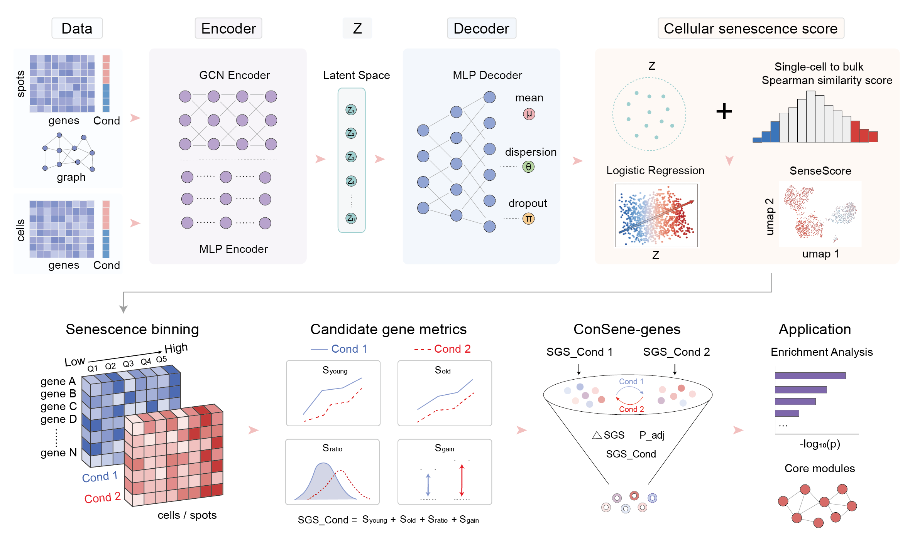

# ConSenPy: detecting context-specific senescence programs from single-cell and spatial transcriptomics
<p align="center">
  
</p>


## 📦 Installation

### 1. Create a clean python environment

We recommend starting from a clean conda environment to avoid potential dependency conflicts.

```bash
conda create -n ConSenPy python=3.9
conda activate ConSenPy
```

### 2. Install pytorch

For GPU acceleration, please install the appropriate PyTorch version according to your CUDA version.


```bash
pip install torch==2.4.0 --index-url https://download.pytorch.org/whl/cu121
```

### 3. Install ConSenPy

```bash
pip install git+https://github.com/Hongyu-Zhao-HMU/ConSenPy.git
```

## 📖 Usage

Run ConSenPy in Python.

### Import ConSenPy

```python
import scanpy as sc
from ConSenPy import (
    preprocess_data,
    calculate_cell_senescence_scores,
    calculate_differential_sgs
)
```

### Load and preprocess single cell data

```python
adata = sc.read_h5ad("path/your_data.h5ad")
adata_preprocessed = preprocess_data(adata)
```

### Calculate cellular senescence scores

```python
adata_scored = calculate_cell_senescence_scores(adata_preprocessed)
```

The predicted senescence scores are stored in:

```python
adata_scored.obs["SenseScore"]
```

### Identify context-specific senescence genes (ConSene-genes)

```python
adata.obs["SenseScore"] = adata_scored.obs["SenseScore"]
ConSene-genes = calculate_differential_sgs(
    adata,
    groupby="condition",
    label_1="cond.1",
    label_2="cond.2",
    level="cell/sample",
    condition_filter="cond.1/cond.2/both"
)
```

Save identified ConSene-genes:

```python
ConSene-genes.to_csv("/path/ConSene-genes.csv")
```